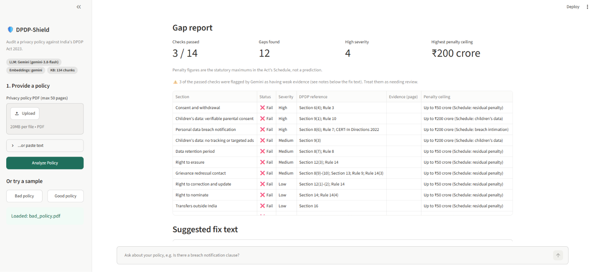
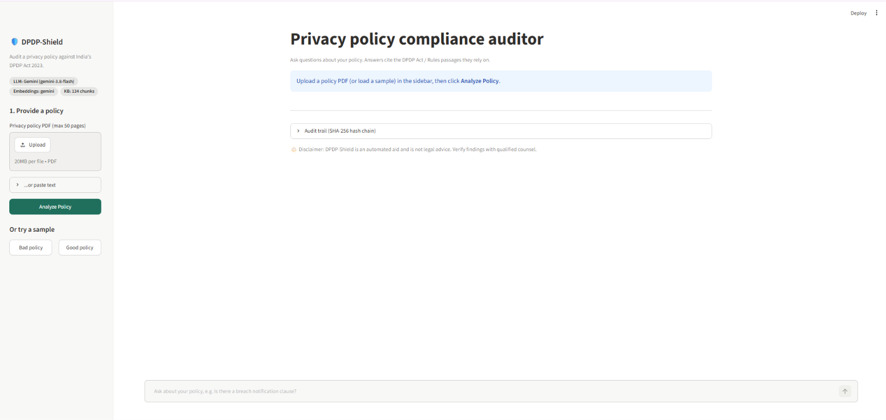
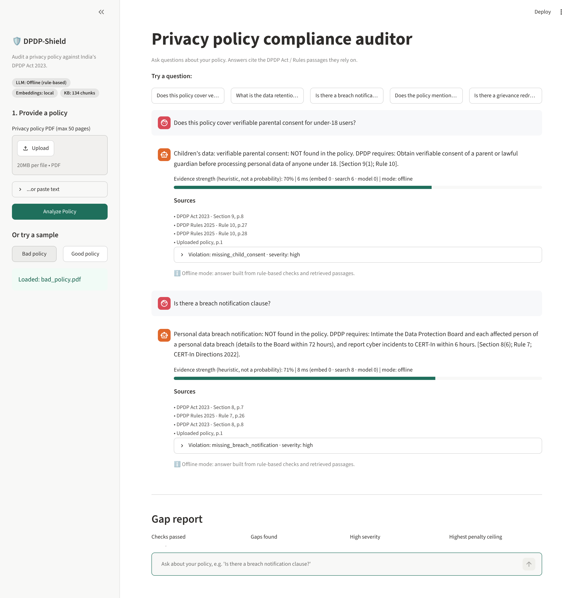
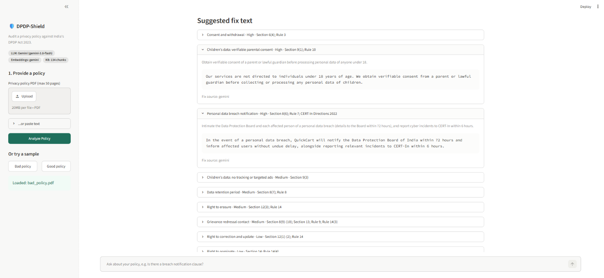
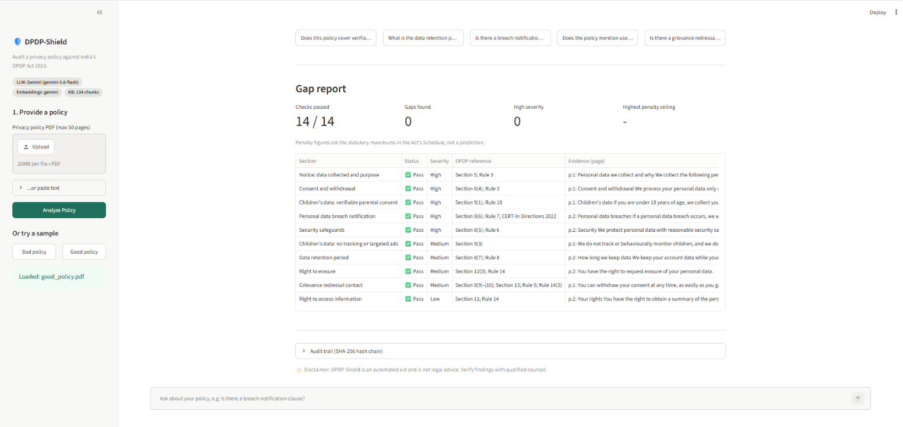
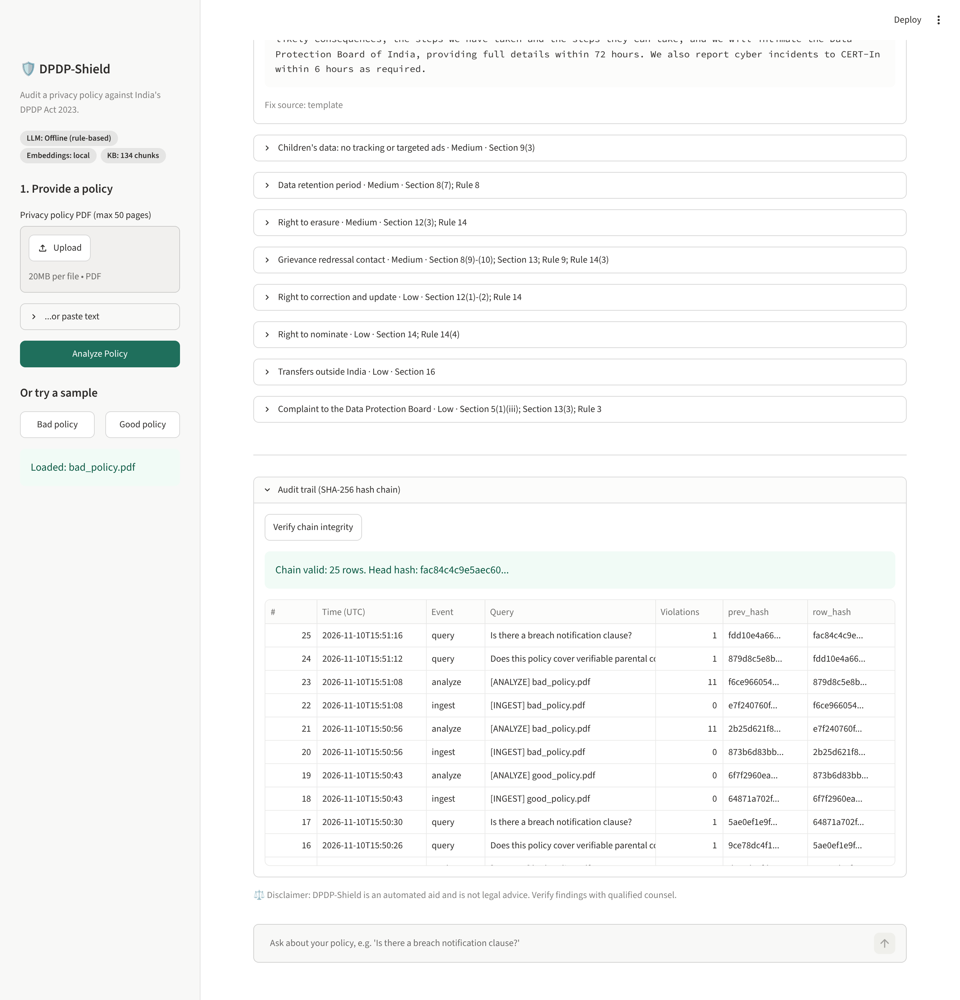

# 🛡️ DPDP-Shield

RAG-based auditor that checks an Indian startup's privacy policy against the **Digital Personal Data Protection Act 2023** and DPDP Rules. Upload a PDF, ask questions, get cited answers, a section-by-section gap report, ready-to-paste fix clauses, and a tamper-evident audit trail.

> ⚖️ Automated aid only. **Not legal advice.**



*Screenshots were captured in **offline mode** (rule-based answers and local embeddings; no Gemini key), so they show the 11 rule-based gaps and template fix text. With a Gemini key the same screens also show Gemini-written fix drafts, advisory notes on weak passes, model-written chat answers, and sometimes one extra AI-suggested gap (which can differ between runs).*

## Screenshots

| | |
|---|---|
| **Home** - example questions, sample policies<br> | **Cited answers** - Act/Rules section and PDF page<br> |
| **Gap report** - 14 checks, severity, penalty ceiling<br> | **Fix text** - ready-to-paste clauses per gap<br> |
| **Good sample** - all keyword checks present (not a finding of compliance)<br> | **Audit trail** - SHA-256 hash chain, verify button<br> |

## Features

| Area | What it does |
|---|---|
| Ingestion | PDF (pdfplumber, ≤50 pages, ≤20 MB) or pasted text → page-aware chunks (~500 tokens, ~50 overlap) → ChromaDB |
| RAG | Top-5 DPDP passages + top-5 passages from *your* policy; the sections governing the matched topic are pinned into context |
| Violation detector | 14 deterministic rule checks (child consent, retention, breach, erasure, grievance, security, ...) **plus** a Gemini semantic review for nuanced gaps |
| Gap report | `{section, status, dpdp_ref, severity, evidence+page, fix_suggestion, penalty ceiling}` table |
| Fix text | Suggested clause per gap (Gemini-tailored when a key is set, built-in templates otherwise). A starting point for a lawyer, not final wording |
| Audit trail | SHA-256 hash chain in SQLite; `/audit/verify` endpoint + UI button |
| Interfaces | Streamlit UI (`app.py`), FastAPI (`dpdp_shield/api.py`) and an Angular web UI (`frontend/`, see below) |

Query output shape (real output from the offline build; `page` is the position in the bundled PDF, i.e. page 8 of `dpdp_act_2023.pdf`):
```json
{"answer": "Children's data: verifiable parental consent: NOT found in the policy. DPDP requires: Obtain verifiable consent of a parent or lawful guardian before processing personal data of anyone under 18. [Section 9(1); Rule 10].",
 "citations": [
   {"source": "DPDP Act 2023",   "section": "Section 9", "title": "", "page": 8, "origin": "official-pdf", "scope": "dpdp"},
   {"source": "DPDP Rules 2025", "section": "Rule 10", "title": "Verifiable consent for processing of personal data of child", "page": 27, "origin": "official-pdf", "scope": "dpdp"},
   {"source": "Uploaded policy", "section": "", "title": "", "page": 1, "origin": "user-policy", "scope": "policy"}],
 "violations": [{"type": "missing_child_consent", "severity": "high", "source": "rules"}],
 "confidence": 0.7, "mode": "offline"}
```
With a Gemini key, `mode` is `gemini` and the answer text is model-written from the retrieved passages.

## Setup

Python 3.11+ is expected (tested on 3.11 and 3.13).

**Windows (CMD)**
```bat
python -m venv .venv
.venv\Scripts\activate
python -m pip install -r requirements.txt
copy .env.example .env
:: open .env and put your key after GEMINI_API_KEY=
python -m streamlit run app.py
```

**macOS / Linux**
```bash
python -m venv .venv && source .venv/bin/activate
pip install -r requirements.txt
cp .env.example .env        # then put your key in GEMINI_API_KEY
streamlit run app.py
```

The UI opens on http://localhost:8501. Optional extras:
```bash
uvicorn dpdp_shield.api:app --reload      # REST API on :8000 (docs at /docs)
pip install -r requirements-dev.txt       # only needed for tests / regenerating samples
pytest                                    # 63 backend tests, no network or key needed (about 4 min)
python scripts/make_samples.py            # regenerate samples/*.pdf
```

Get a free key at <https://aistudio.google.com/apikey>. **No key? It still runs** in offline mode (rule-based answers + local embeddings); the sidebar badge shows which mode is active.

Try the two samples (`samples/bad_policy.pdf`, `samples/good_policy.pdf`) via the sidebar buttons, then ask:
- Does this policy cover verifiable parental consent for under-18 users?
- What is the data retention period mentioned?
- Is there a breach notification clause?
- Does the policy mention user rights to delete data?
- Is there a grievance redressal contact?

Measured offline: bad policy → 11 violations, good policy → 0; queries answer in ~10-30 ms.

## Web UI (Angular)

A separate Angular frontend lives in [`frontend/`](frontend/): pick a bundled sample (or upload your own where the server allows it), run the checks,
filter potential gaps by status, severity and source (deterministic rules vs AI suggestions), ask questions with citations, and verify the audit chain.

```bash
uvicorn dpdp_shield.api:app --port 8000     # backend
cd frontend && npm ci && npm start          # http://localhost:4200
```

Setup, tests, build, deployment and limitations: [`frontend/README.md`](frontend/README.md). The API it uses is documented in [`docs/API_CONTRACT.md`](docs/API_CONTRACT.md).
Needs a current Node.js LTS. The UI reads the server's limits and upload availability from `GET /config`, never retries uploads, analysis or questions automatically, and words every result as a "potential gap", never a legal finding.

Backend settings added for it (all optional, see `.env.example`):

| Variable | Effect |
|---|---|
| `DEMO_MODE=true` | Server refuses PDF/text uploads (403), requires `policy_id` on `/audit`, turns on rate limiting. Bundled samples still work |
| `CORS_ORIGINS` | Comma-separated allowlist of browser origins (default: `localhost:4200`) |
| `RATE_LIMIT_PER_MIN` | Per-client limit on costly POSTs (default 20 in demo mode, otherwise off) |
| `MAX_TEXT_CHARS` | Cap for pasted policy text (default 100000) |

Rule-based results are repeatable; AI-suggested gaps can differ between runs. There is **no authentication or per-user isolation**: the `policy_id` is the only capability, so do not enable arbitrary uploads on a shared public server.

## Architecture

```
frontend/ (Angular) ──HTTP──► dpdp_shield/api.py (FastAPI) ─┐
app.py (Streamlit) ─────────────────────────────────────────┴─► pipeline.Shield
   ingestion.py   PDF → pages → chunks            retrieval.py  ChromaDB + KB loader
   embeddings.py  Gemini | local hash embedder    rules.py      14 regex compliance checks
   llm.py         Gemini wrapper, prompts, validators   report.py  gap report
   audit.py       SHA-256 hash chain (SQLite)
knowledge_base/   official Act + Rules PDFs; unofficial CERT-In summary + template (see caveat 1)
```

Design choices worth knowing:
- **Citations can't be hallucinated.** Context blocks get ids (`[K1]`, `[P2]`); the model may only cite ids, and we map them back to real retrieved metadata. Unknown ids are dropped.
- **Rules have the final say on pass/fail.** The LLM can add fixes, extra gaps and "weak pass" warnings, but cannot flip a rule result.
- **Graceful degradation.** Gemini errors/timeouts fall back to the rule-based answer with a visible warning.
- The `confidence` value is a **heuristic** (retrieval strength + rule match + a small weight on the model's own estimate), shown in the UI as "evidence strength" and capped at 90%. It is not a calibrated probability.
- LLM "weak pass" notes and extra gaps are advisory hints (marked "LLM-suggested, verify"); only the rule engine decides pass/fail.

## ⚠️ Important caveats (read before demoing)

1. **Knowledge base - what is official and what is not.**
   - **Official:** `dpdp_act_2023.pdf` (Gazette, 11 Aug 2023) and `dpdp_rules_2025.pdf` (G.S.R. 846(E), 13 Nov 2025) are indexed directly from the PDFs and cited with PDF page numbers. The section/rule references in `rules.py` were checked against that text on 10 Nov 2026 (this corrected Rule 11→12 for child-data exemptions and Section 5(1)(ii)→(iii) for Board complaints).
   - **Unofficial:** `cert_in_directions_2022.md` and `compliant_policy_template.md` are the author's own summaries, **not** official text and not verified against the originals. The UI tags them "(working summary)". Treat anything citing them as unverified.
   - **Page numbers** are positions in the bundled PDF. The Rules PDF has the Hindi version first (pages 1-23, not indexed but counted), so the first English page is page 24; the Act PDF is English only. The printed Gazette page number equals the PDF page number in both files.
   - To use another edition, replace the PDFs (filenames must contain `act` / `rules` / `cert`).
2. **Gemini model names change and capacity varies.** The live Gemini path (gap-report review and Q&A) was tested **manually by the author** in Nov 2026 (`gemini-3.8-flash` for the gap review, `gemini-3.5-flash-lite` for chat; answer time varied from a few seconds to about 17 s across a small number of manual runs, depending on model and Google-side load; this is not a formal benchmark, and repeated questions skip the embedding call). The automated tests use a fake model, and the offline path (rule-based answers, local embeddings) answers in ~10-30 ms. Google retires models and returns `503 high demand` at busy times, so three settings exist: `GEMINI_MODEL` (gap review), `GEMINI_QUERY_MODEL` (faster chat answers) and `GEMINI_FALLBACK_MODEL` (tried after retries fail). First start with Gemini embeddings indexes ~134 chunks, which can pause ~1 minute on the free tier's 100 requests/minute limit.
3. **Rule checks are wording heuristics.** "Pass" means the policy mentions the element, not that it is legally sufficient.
4. **Audit chain is tamper-*evident*.** Anyone with write access to the whole SQLite file could rebuild it; publish `head_hash` somewhere you trust for stronger guarantees.
5. Penalty figures are the Act's Schedule ceilings, not predictions. Scanned PDFs need OCR (not included); paste the text instead.
6. Uploaded policies are stored under `data/` until replaced or deleted (`DELETE /policies/{id}`). Deleting a policy does **not** remove its audit-log rows (they contain the question text); they cannot be removed without breaking the hash chain.

## Troubleshooting

| Symptom | Cause / fix |
|---|---|
| Badge says **Offline** | No key was read. The file must be named exactly `.env` (not `.env.txt`, not `.env.example`) in the project folder. Check with `python -c "import os; from dotenv import load_dotenv; load_dotenv(); print(bool(os.getenv('GEMINI_API_KEY')))"` (should print `True`). Put a `#` comment on line 1 and save as UTF-8. |
| `Gemini embeddings unavailable (ConnectError)` | Network was down when the app started. Check connectivity, then restart the app (connectivity is tested at startup). |
| `503 UNAVAILABLE ... high demand` | Google-side capacity. The app retries, then tries `GEMINI_FALLBACK_MODEL`; use the **Retry Gemini review** button, or set `GEMINI_MODEL` to a lighter "flash-lite" model. |
| `404 NOT_FOUND ... no longer available` | Model retired. Pick a current name: `python -c "from google import genai; import os; from dotenv import load_dotenv; load_dotenv(); c=genai.Client(api_key=os.getenv('GEMINI_API_KEY')); [print(m.name) for m in c.models.list() if 'generateContent' in (m.supported_actions or [])]"` |
| Windows: `Fatal error in launcher` | Broken pip/streamlit launcher. Use `python -m pip ...` and `python -m streamlit run app.py` inside a fresh `.venv`. |
| `pip` read timeouts | Slow network: `python -m pip install --default-timeout=120 --retries 10 -r requirements.txt`. |

Never put your key in `.env.example` or commit `.env`.

## Sources and license

- **Digital Personal Data Protection Act, 2023** (No. 22 of 2023), The Gazette of India Extraordinary, Part II, Section 1, No. 25, 11 August 2023 - Ministry of Law and Justice, Government of India.
- **Digital Personal Data Protection Rules, 2025**, G.S.R. 846(E), 13 November 2025 - Ministry of Electronics and Information Technology, Government of India.

Both are public Government of India Gazette publications, bundled unmodified in `knowledge_base/` for retrieval. They are not covered by this project's license. Please check the current official versions (egazette.gov.in / meity.gov.in) for amendments.

Code: MIT License (see `LICENSE`).

## Deploy

> **Before deploying publicly:** a public app uses *your* Gemini key and quota for every visitor, has no login, and stores the audit log on the server where all visitors share it. On hosts with an ephemeral disk the knowledge-base index is rebuilt on each cold start. For a public demo, run the API with `DEMO_MODE=true` (samples only; uploads are blocked on the server, not just hidden), set `CORS_ORIGINS` to your exact frontend origin, use a separate restricted key or `EMBEDDINGS_BACKEND=local`, and keep the API behind HTTPS. The rate limiter is in-memory and per process.


**Streamlit Community Cloud:** push to GitHub → New app → `app.py` → add `GEMINI_API_KEY` under *Secrets*. Note the filesystem is ephemeral (audit log and index reset on restart).
**Render:** Web service, build `pip install -r requirements.txt`, start `streamlit run app.py --server.port $PORT --server.address 0.0.0.0`, add `GEMINI_API_KEY` env var, attach a disk mounted at `data/` to keep the audit log.

## Layout
```
app.py  requirements.txt  requirements-dev.txt  .env.example  README.md  LICENSE
dpdp_shield/   core package        knowledge_base/  Act + Rules PDFs, unofficial CERT-In/template
samples/       bad + good policy (.txt/.pdf)        tests/  pytest suite
screenshots/   Streamlit UI captures                scripts/make_samples.py
frontend/      Angular web UI (own README, Vitest + Playwright tests)
docs/          API_CONTRACT.md (endpoints, schemas, known gaps)
```
